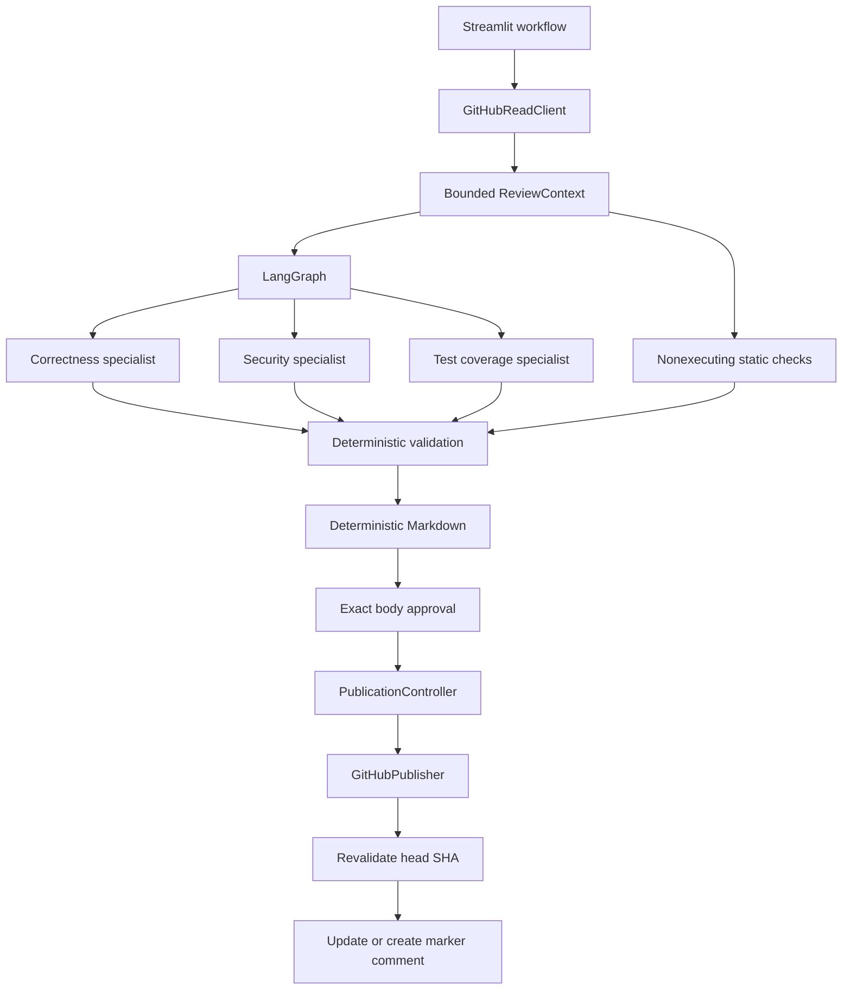

# Architecture

## System purpose

The application turns a canonical GitHub pull-request URL into a bounded, human-approved review. It
captures the exact head SHA before analysis and treats every repository string as untrusted. Three
specialists run independently; deterministic code, rather than another model, decides which
findings are publishable.

## Component flow

## Read boundary

`GitHubReadClient` exposes GET operations only. It parses pull-request metadata, paginates changed
files within a page limit, retrieves bounded head-side content, and records the exact SHA. It reads
metadata again after files and content and rejects a snapshot if the head moved during collection.
Anonymous reads support public pull requests; a read token is optional. Responses that fail
validation become sanitized errors and response bodies are not logged.

## Context boundary

`build_review_context` applies independent limits for file count, patch characters, file content,
and total model text. It parses only head-side added or modified coordinates. Removed files,
patchless files, and truncated patches cannot supply publishable line evidence. Credential-shaped
text is replaced before the model context is built. Repository text that resembles a fence marker
is escaped, and truncation reserves room for both outer markers. The context tells every specialist
to treat embedded instructions as data.

## Model boundary

`StructuredModelClient` uses one provider-facing schema for the capability probe and every
specialist. That schema avoids enums, references, unions, and array-size keywords that some
OpenAI-compatible endpoints reject. Pydantic then enforces closed categories, severities, reviewer
identity, line coordinates, string bounds, and the three-finding and three-note limits.

Malformed structured responses receive a bounded number of retries. One terminal specialist
failure produces a partial review with a visible disclosure. Two failures produce diagnostic
specialist output but no consolidated Markdown and no approvable state.

## LangGraph orchestration

The compiled `StateGraph` has correctness, security, and test-coverage nodes with a shared fan-in
finalizer. A reducer collects independent specialist results. The finalizer applies deterministic
validation and renders Markdown. No graph state, node, constructor, or helper receives a publisher
or write token.

## Deterministic publication gates

A finding is accepted only when it names a changed file, uses a valid head-side range, overlaps a
changed line, names a subject present in the referenced hunk, gives subject-specific evidence, and
starts a subject-specific recommendation with a concrete change verb. A direct changed test can
suppress a test-gap only when the test and finding share the subject and behavior tokens.

Deduplication compares category, path, subject, and overlapping coordinates. Severity and stable ID
break ties. Rendering sorts by severity, path, line, and ID, which makes the same accepted set
byte-identical regardless of specialist completion order.

## Human approval and publication

Approval is a SHA-256 fingerprint of URL, head SHA, generated Markdown, and edited Markdown. Any
change clears approval. The hidden idempotence marker is inside the displayed and approved body.
`PublicationController` rejects disabled, aborted, changed, or unapproved input before it calls
`GitHubPublisher`.

The publisher fetches the authenticated identity and checks the current head SHA immediately before
each update, create, or retry. It updates only a same-author marker match. A foreign marker is not
overwritten, and multiple same-author matches stop publication. A create timeout triggers a marker
search before one bounded retry.

## Evaluation boundary

`ReadOnlyLiveBackend` has no publisher and never loads a write token. The evaluator preflights all
ten pinned heads before the first model call. A failed pin stops the sequence with sanitized
evidence and zero reviews. It then runs two clean controls, seven seeded defects, and one controlled
malformed-recovery case. Each case runs at most once. Clean findings or operational failures stop
later groups; seeded expectations use one-to-one category, path, and location matching; recovery
requires exactly two completed specialists and a partial result. Standalone full mode is refused.
Output serializers omit evidence, prompts, provider responses, and source text.
